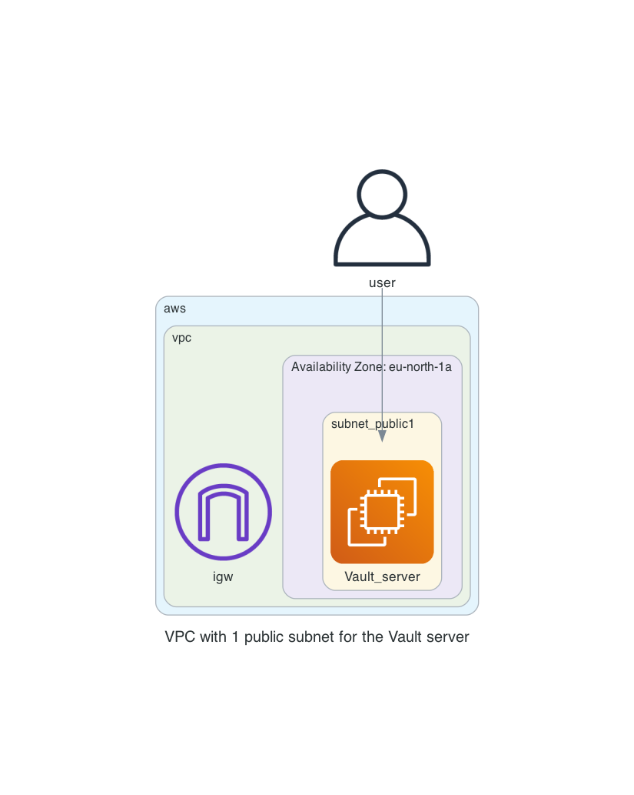

# Vault server standalone

This repository will create a standalone Vault server latest version with public access to use for your own personal testing

# Creating the infrastructure

We create the infrastructure according to the following diagram
  

# Prerequisites
## AWS
We will be using AWS. Make sure you have the following

AWS account

## License
Vault license file

## Vault installation
Make sure you have the Vault tool installed locally with the help of the following documentation found [here](https://developer.hashicorp.com/vault/downloads)

# How to

- Clone this repository
```
git clone https://github.com/munnep/vault_aws_standalone.git
```
- Set your AWS credentials
```
export AWS_ACCESS_KEY_ID=
export AWS_SECRET_ACCESS_KEY=
export AWS_SESSION_TOKEN=
```
- Go into the directory `vault_aws_standalone`
```
cd vault_aws_standalone
```
- Create a file called `variables.auto.tfvars` with the following contents
```
tag_prefix               = "vault1"                         # TAG prefix for names to easily find your AWS resources
region                   = "eu-north-1"                     # Region to create the environment
vpc_cidr                 = "10.234.0.0/16"                  # subnet mask that can be used 
dns_hostname             = "vault1"                         # DNS hostname for the Vault server
dns_zonename             = "aws.munnep.com"                 # DNS zone name to be used
certificate_email        = "patrick.munne@hashicorp.com"    # Your email address used by TLS certificate registration
public_key               = "ssh-rsa AAAAB3Nza"              # The public key for you to connect to the server over SSH
license                  = "<license_code>                  # official license code for your Vault environment 
```
- Initialize terraform
```
terraform init
```
- Create the AWS resources
```
terraform apply
```
- The output should be the following
```
ssh_vault_server = "ssh ubuntu@vault1.aws.munnep.com"
vault_ip = "13.49.110.167"
vault_address = "export VAULT_ADDR='https://vault1.aws.munnep.com:8200'"
vault_dashboard = "https://vault1.aws.munnep.com:8200"
```
- set the VAULT_ADDR environment variable
```
export VAULT_ADDR='https://vault1.aws.munnep.com:8200'
```
- the Vault server is automatically initiated and unsealed. The recovery key and root token can be found on the server itself
```
cat /opt/vault/init_vault.txt 
Recovery Key 1: xxxxxxxxxxxxxxxxxx

Initial Root Token: hvs.xxxxxxxxxxx

Success! Vault is initialized

Recovery key initialized with 1 key shares and a key threshold of 1. Please
securely distribute the key shares printed above.
```


